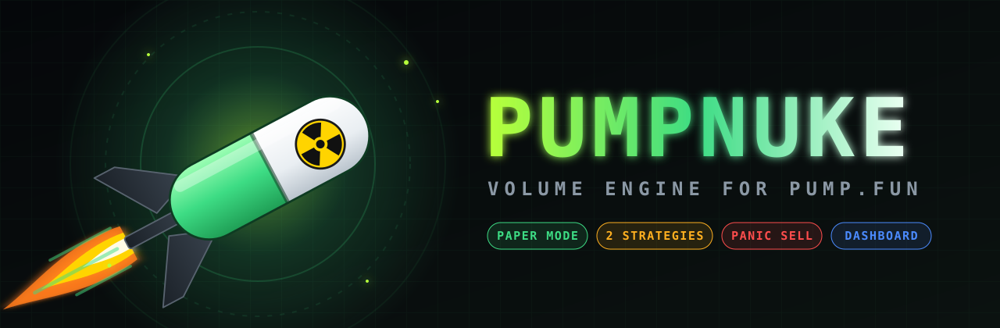

<p align="center">
  
</p>

<p align="center">
  
  
  
  
  
</p>

<h3 align="center">Wallet-pool volume engine for pump.fun — CLI + live dashboard + paper mode</h3>

<p align="center">
  <a href="#-quick-start"><b>Quick Start</b></a> ·
  <a href="#-how-it-works"><b>How It Works</b></a> ·
  <a href="#-strategies"><b>Strategies</b></a> ·
  <a href="#-cli"><b>CLI</b></a> ·
  <a href="#-dashboard"><b>Dashboard</b></a> ·
  <a href="#-configuration"><b>Config</b></a> ·
  <a href="#-under-the-hood"><b>Internals</b></a> ·
  <a href="#-faq"><b>FAQ</b></a>
</p>

<p align="center"></p>

## ☢ Overview

PUMPNUKE spins up a pool of fresh Solana wallets, funds them from a master wallet, and runs continuous buy/sell cycles on a pump.fun token with rotating wallets, randomized sizes and strategy-driven timing. When the run ends — or you hit `Ctrl+C` — it sells every remaining token and drains all SOL back to the master wallet.

Everything can run in **paper mode** first: same engine, same logs, zero transactions.

<p align="center">
  
</p>

<p align="center"></p>

## ⚡ Features

<p align="center">
  
</p>

<table>
<tr>
<td width="50%" valign="top">

### Engine
- Three-phase lifecycle: **fund → initial buy → cycling**
- LRU wallet rotation, never the same wallet twice in a row
- Buy bias control (default 60% buys)
- Partial sells: 40–70% of holdings per sell
- Bonding curve **and** PumpSwap AMM detection
- `BigInt` math everywhere, SOL handled in lamports

</td>
<td width="50%" valign="top">

### Safety
- **Paper mode** on by default (`DRY_RUN=true`)
- Preview + confirmation before every run
- Auto-stop after **5 consecutive errors**
- `Ctrl+C` handler: stop → sell all → drain → session stats
- One-command **panic sell** and **drain**
- Every job persisted to `data/jobs/*.json`

</td>
</tr>
</table>

<p align="center"></p>

## 🚀 Quick Start

```bash
git clone https://github.com/zostaff/PUMPNUKE.git
cd PUMPNUKE
npm install
cp .env.example .env
```

Fill in `.env`:

```env
RPC_URL=https://mainnet.helius-rpc.com/?api-key=YOUR_KEY
WALLET_PRIVATE_KEY=your_base58_private_key
DRY_RUN=true
```

Run a paper simulation:

```bash
node cli/nuke.mjs --mint <TOKEN_CA> --budget 0.5 --wallets 8 --strategy staggered
```

Go live once the simulation looks right:

```bash
# .env → DRY_RUN=false
node cli/nuke.mjs --mint <TOKEN_CA> --budget 0.5 --wallets 8 --strategy staggered
```

Open the dashboard:

```bash
node dashboard/server.mjs   # → http://localhost:3002
```

<p align="center"></p>

## 🔁 How It Works

<p align="center">
  
</p>

| Phase | What happens | Details |
|:---:|---|---|
| **1 · Fund** | Master sends SOL to each pool wallet | Equal split of budget, 500 ms between transfers |
| **2 · Initial buy** | Every wallet opens a position | 30–50% of wallet balance, timing set by strategy |
| **3 · Cycling** | Rotating buy/sell loop until duration ends | Buy ~30% of SOL or sell 40–70% of tokens |
| **4 · Cleanup** | Exit everything | `sellAll` on holders → `drainWallets` to master |

<details>
<summary><b>Cycle decision logic</b></summary>

```text
loop until (now >= endTime) or job.stopping:
    pool    = wallets except previous
    pool    = sort by lastUsedAt ascending
    pick    = random of first 3 in pool
    isBuy   = !pick.hasTokens  or  random() < buyBias
    if isBuy:  buy  30% of (balance − fee reserve)
    else:      sell 40–70% of token balance
    on error:  consecutiveErrors++ → stop at 5
    sleep(strategy.cycleDelay())
```

</details>

<p align="center"></p>

## 🎯 Strategies

<p align="center">
  
</p>

| | `basic` | `staggered` |
|---|:---:|:---:|
| Budget distribution | equal | equal |
| Initial buy | all wallets at once | 2–6 s between wallets |
| Delay between trades | 1–3 s | 2–8 s |
| Trade density | high | medium |
| Default | | ✔ |

<p align="center"></p>

## 🖥 CLI

<table>
<tr><th>Command</th><th>Purpose</th></tr>
<tr><td><code>node cli/nuke.mjs --mint &lt;CA&gt;</code></td><td>Preview → confirm → start a volume job</td></tr>
<tr><td><code>node cli/status.mjs [jobId]</code></td><td>List all jobs, or details + last 10 trades</td></tr>
<tr><td><code>node cli/panic.mjs &lt;jobId&gt;</code></td><td>Sell every token from every wallet, then drain</td></tr>
<tr><td><code>node cli/drain.mjs &lt;jobId&gt;</code></td><td>Return SOL to master without selling</td></tr>
</table>

### `nuke.mjs` flags

| Flag | Description | Default |
|---|---|:---:|
| `-m, --mint` | Token contract address | **required** |
| `-b, --budget` | Total SOL budget | `0.5` |
| `-w, --wallets` | Wallets in the pool | `8` |
| `-s, --strategy` | `basic` \| `staggered` | `staggered` |
| `-d, --duration` | Run length, minutes | `15` |
| `--bias` | Buy probability `0–1` | `0.6` |
| `--slippage` | Slippage, bps | `1000` |
| `-y, --yes` | Skip confirmation prompt | `false` |
| `-h, --help` | Show help | |

### npm scripts

```bash
npm run nuke -- --mint <CA> --budget 0.3
npm run status
npm run panic -- <jobId>
npm run drain -- <jobId>
npm run dashboard
```

<p align="center"></p>

## 📊 Dashboard

<p align="center">
  
</p>

Vanilla JS, dark theme, monospace, refreshes every 3 seconds. Start jobs from a form, watch buys/sells and the trade log live, stop or panic-sell with one click.

<details>
<summary><b>REST API</b></summary>

| Method | Endpoint | Description |
|:---:|---|---|
| `GET` | `/api/jobs` | All jobs + current mode |
| `GET` | `/api/jobs/:id` | Job details, wallets (public keys only), last 50 trades |
| `POST` | `/api/jobs` | Create and start a job |
| `POST` | `/api/jobs/:id/stop` | Graceful stop |
| `POST` | `/api/jobs/:id/panic` | Panic sell + drain |

```bash
curl -X POST http://localhost:3002/api/jobs \
  -H 'Content-Type: application/json' \
  -d '{"mint":"<CA>","budget":0.3,"numWallets":6,"strategy":"basic","durationMin":10}'
```

</details>

<p align="center"></p>

## ⚙ Configuration

| Variable | Description | Default |
|---|---|:---:|
| `RPC_URL` | Solana RPC endpoint | public mainnet |
| `WALLET_PRIVATE_KEY` | Master wallet, base58 | — |
| `DRY_RUN` | Paper mode | `true` |
| `DEFAULT_STRATEGY` | `basic` / `staggered` | `staggered` |
| `DEFAULT_WALLETS` | Pool size | `8` |
| `DEFAULT_BUDGET` | Budget, SOL | `0.5` |
| `DEFAULT_DURATION_MIN` | Run length, minutes | `15` |
| `DEFAULT_BUY_BIAS` | Buy probability | `0.6` |
| `DEFAULT_SLIPPAGE_BPS` | Slippage, bps | `1000` |
| `PRIORITY_FEE` | Compute unit price, µLamports | `300000` |
| `JITO_TIP` | Jito tip, SOL | `0.0001` |
| `DASHBOARD_PORT` | Dashboard port | `3002` |
| `SOL_RESERVE` | SOL kept per wallet for fees | `0.01` |

<p align="center"></p>

## 🔬 Under the Hood

```text
pumpnuke/
├── lib/
│   ├── config.mjs          env loading, connection, master keypair
│   ├── constants.mjs       compute limits, Jito endpoint + tip accounts
│   ├── logger.mjs          ANSI colors: buy green · sell red · fund yellow · drain blue
│   ├── wallet-pool.mjs     generateWallets · fundWallets · drainWallets · sellAll
│   ├── trade-builder.mjs   buildBuy / buildSell via @pump-fun/pump-sdk + pump-swap-sdk
│   ├── volume-engine.mjs   runVolume — the three-phase loop, paper + live
│   ├── job-manager.mjs     prepare → confirm → running → stop, persistence, SIGINT
│   └── jito.mjs            single-endpoint bundle submit + status polling
├── cli/                    nuke · status · panic · drain
├── dashboard/              server.mjs + public/index.html
└── assets/                 README artwork
```

<details>
<summary><b>Transactions</b></summary>

- `VersionedTransaction` v0 messages
- `ComputeUnitLimit` 250 000, `ComputeUnitPrice` from `PRIORITY_FEE`
- Simple `getLatestBlockhash` + `sendTransaction` with `maxRetries: 3`
- Token program auto-detected from the mint owner (SPL / Token-2022)
- Venue auto-detected: bonding curve → `buyV2Instructions` / `sellV2Instructions`, graduated → PumpSwap `buyQuoteInput` / `sellBaseInput`

</details>

<details>
<summary><b>Job lifecycle</b></summary>

```text
prepared ──confirm──▶ funding ──▶ buying ──▶ running ──▶ cleanup ──▶ completed
                         │           │          │
                         └───────────┴──stop────┴──────▶ stopped
                                                 panic ─▶ panic-stopped
                                         any fatal error ─▶ failed (auto drain)
```

Only one active job at a time. Jobs are saved every 10 s and on every status change.

</details>

<details>
<summary><b>Paper mode</b></summary>

With `DRY_RUN=true` the engine never touches the network for trades. It simulates per-wallet SOL and token balances, runs the same rotation and buy/sell decisions, writes the same trade records (flagged `simulated: true`) and shortens delays so a 1-minute run produces ~200 cycles.

</details>

<p align="center"></p>

## ❓ FAQ

<details>
<summary><b>What happens if I press Ctrl+C mid-run?</b></summary>

All active jobs get `stopping = true`, the loop exits, remaining tokens are sold, SOL is drained to master and session stats are printed. Press `Ctrl+C` twice to force-quit.
</details>

<details>
<summary><b>The job stopped by itself.</b></summary>

Five failed trades in a row trigger auto-stop — usually a dead token, a drained curve or an RPC problem. Check `node cli/status.mjs <jobId>` for the last errors.
</details>

<details>
<summary><b>Where are the wallet keys?</b></summary>

In `data/jobs/<id>.json`, plaintext. The folder is git-ignored. Run `node cli/drain.mjs <id>` to recover SOL from any job at any time.
</details>

<details>
<summary><b>Does it work after the token graduates?</b></summary>

Yes. The trade builder checks the bonding curve state on every trade and switches to PumpSwap automatically.
</details>

<p align="center"></p>

## ✅ Can / ❌ Cannot

| ✅ Can | ❌ Cannot |
|---|---|
| Run buy/sell cycles across 2–20 wallets | Guarantee profit — fees and slippage cost SOL |
| Simulate everything in paper mode | Launch new tokens |
| Panic-sell and drain in one command | Adjust priority fees dynamically |
| Trade on curve and PumpSwap | Encrypt stored wallet keys |
| Monitor runs from a web dashboard | Recover keys if `data/` is deleted |

## ⚠ Disclaimer

For educational and research purposes only. Trading crypto carries a high risk of loss. Artificial volume can mislead other market participants and may be illegal in your jurisdiction or against platform terms. You are solely responsible for how you use this software.

<p align="center">
  
  <br><sub>MIT · built by <a href="https://github.com/zostaff">zostaff</a></sub>
</p>
