<p align="center">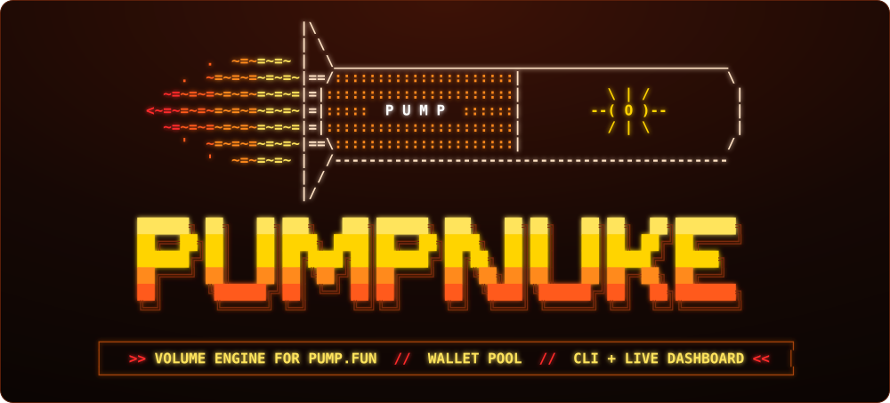</p>

<p align="center">
  
  
  
  
</p>

<p align="center">
  <b><a href="#01--quick-start">[ quick start ]</a></b> ·
  <b><a href="#02--how-it-works">[ flow ]</a></b> ·
  <b><a href="#03--strategies">[ strategies ]</a></b> ·
  <b><a href="#04--cli">[ cli ]</a></b> ·
  <b><a href="#05--dashboard">[ dashboard ]</a></b> ·
  <b><a href="#06--configuration">[ config ]</a></b> ·
  <b><a href="#07--under-the-hood">[ internals ]</a></b> ·
  <b><a href="#08--faq">[ faq ]</a></b>
</p>

<p align="center"></p>

<p align="center">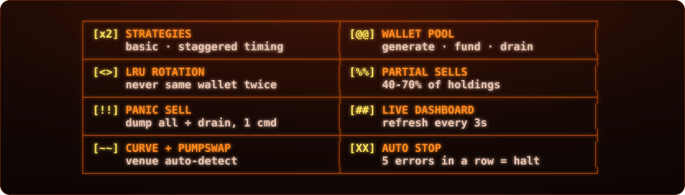</p>

PUMPNUKE spins up a pool of fresh Solana wallets, funds them from your master wallet and runs continuous buy/sell cycles on a pump.fun token — rotating wallets, randomized sizes, strategy-driven timing. When the run ends or you hit `Ctrl+C`, it sells every remaining token and drains all SOL back to master.

<p align="center">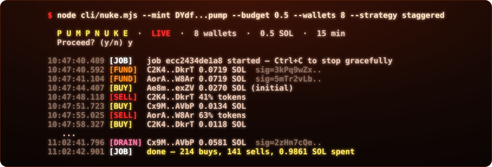</p>

<p align="center"></p>

<a id="01--quick-start"></a>
<p align="center"></p>

```bash
git clone https://github.com/zostaff/PUMPNUKE.git && cd PUMPNUKE
npm install
cp .env.example .env
```

```env
RPC_URL=https://mainnet.helius-rpc.com/?api-key=YOUR_KEY
WALLET_PRIVATE_KEY=your_base58_private_key
DRY_RUN=false
```

```bash
node cli/nuke.mjs --mint <TOKEN_CA> --budget 0.5 --wallets 8 --strategy staggered
node dashboard/server.mjs        # -> http://localhost:3002
```

<p align="center"></p>

<a id="02--how-it-works"></a>
<p align="center"></p>

<p align="center">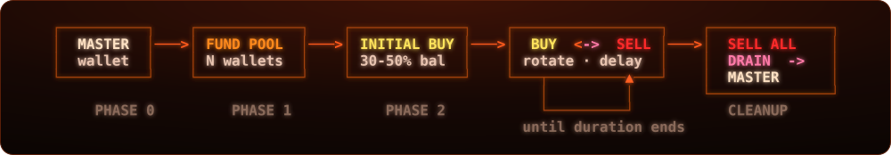</p>

| phase | action | details |
|:---:|---|---|
| `0` | master holds the budget | balance checked before start |
| `1` | **fund** pool wallets | equal split, 500 ms between transfers |
| `2` | **initial buy** | 30–50% of each wallet's SOL, timing per strategy |
| `3` | **cycling** | rotating buy/sell until duration ends |
| `·` | **cleanup** | `sellAll` → `drainWallets` → master |

<p align="center">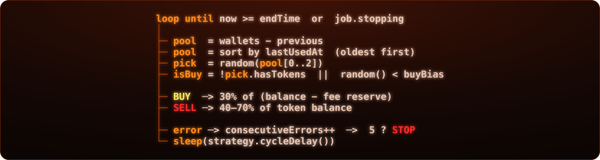</p>

<p align="center"></p>

<a id="03--strategies"></a>
<p align="center"></p>

<p align="center">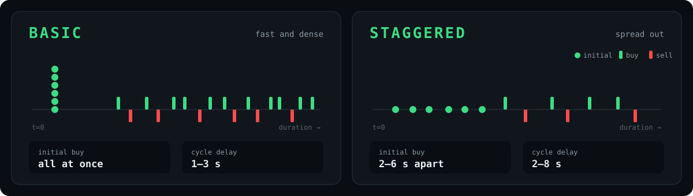</p>

| | `basic` | `staggered` |
|---|:---:|:---:|
| distribution | equal | equal |
| initial buy | all at once | 2–6 s apart |
| trade delay | 1–3 s | 2–8 s |
| density | high | medium |
| default | | ✔ |

<p align="center"></p>

<a id="04--cli"></a>
<p align="center"></p>

<p align="center"></p>

| flag | description | default |
|---|---|:---:|
| `-m, --mint` | token contract address | **required** |
| `-b, --budget` | total SOL budget | `0.5` |
| `-w, --wallets` | wallets in the pool | `8` |
| `-s, --strategy` | `basic` \| `staggered` | `staggered` |
| `-d, --duration` | run length, minutes | `15` |
| `--bias` | buy probability `0–1` | `0.6` |
| `--slippage` | slippage, bps | `1000` |
| `-y, --yes` | skip confirmation | `false` |

```bash
npm run nuke -- --mint <CA> --budget 0.3
npm run status
npm run panic -- <jobId>
npm run drain -- <jobId>
npm run dashboard
```

<p align="center"></p>

<a id="05--dashboard"></a>
<p align="center"></p>

<p align="center">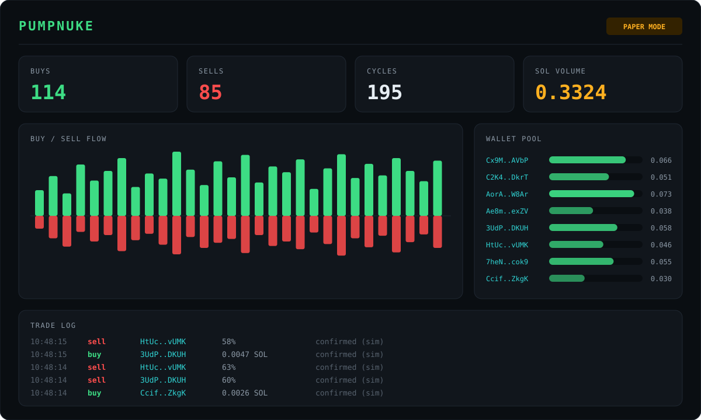</p>

| method | endpoint | description |
|:---:|---|---|
| `GET` | `/api/jobs` | all jobs |
| `GET` | `/api/jobs/:id` | details, public keys, last 50 trades |
| `POST` | `/api/jobs` | create + start a job |
| `POST` | `/api/jobs/:id/stop` | graceful stop |
| `POST` | `/api/jobs/:id/panic` | panic sell + drain |

```bash
curl -X POST http://localhost:3002/api/jobs \
  -H 'Content-Type: application/json' \
  -d '{"mint":"<CA>","budget":0.3,"numWallets":6,"strategy":"basic","durationMin":10}'
```

<p align="center"></p>

<a id="06--configuration"></a>
<p align="center"></p>

| variable | description | default |
|---|---|:---:|
| `RPC_URL` | Solana RPC endpoint | public mainnet |
| `WALLET_PRIVATE_KEY` | master wallet, base58 | — |
| `DRY_RUN` | set to `false` | `false` |
| `DEFAULT_STRATEGY` | `basic` / `staggered` | `staggered` |
| `DEFAULT_WALLETS` | pool size | `8` |
| `DEFAULT_BUDGET` | budget, SOL | `0.5` |
| `DEFAULT_DURATION_MIN` | run length, minutes | `15` |
| `DEFAULT_BUY_BIAS` | buy probability | `0.6` |
| `DEFAULT_SLIPPAGE_BPS` | slippage, bps | `1000` |
| `PRIORITY_FEE` | compute unit price, µLamports | `300000` |
| `JITO_TIP` | Jito tip, SOL | `0.0001` |
| `DASHBOARD_PORT` | dashboard port | `3002` |
| `SOL_RESERVE` | SOL kept per wallet for fees | `0.01` |

<p align="center"></p>

<a id="07--under-the-hood"></a>
<p align="center"></p>

<p align="center">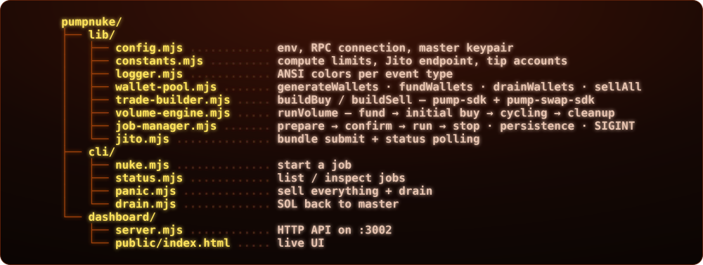</p>

<p align="center">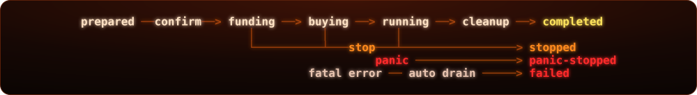</p>

<p align="center">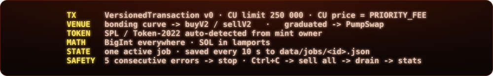</p>

<p align="center"></p>

<a id="08--faq"></a>
<p align="center"></p>

<details>
<summary><b>> Ctrl+C mid-run?</b></summary>

All active jobs stop, remaining tokens are sold, SOL is drained to master and session stats are printed. Press twice to force-quit.
</details>

<details>
<summary><b>> Job stopped by itself?</b></summary>

Five failed trades in a row trigger auto-stop — dead token, drained curve or RPC issues. Check `node cli/status.mjs <jobId>`.
</details>

<details>
<summary><b>> Where are the wallet keys?</b></summary>

`data/jobs/<id>.json`, plaintext, git-ignored. `node cli/drain.mjs <id>` recovers SOL from any job.
</details>

<details>
<summary><b>> Token graduated mid-run?</b></summary>

The trade builder checks the curve on every trade and switches to PumpSwap automatically.
</details>

<p align="center"></p>

<p align="center">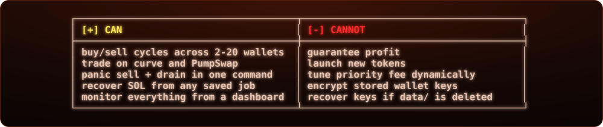</p>

<p align="center"></p>

<p align="center"></p>

<p align="center"><sub>built by <a href="https://github.com/zostaff">zostaff</a></sub></p>
